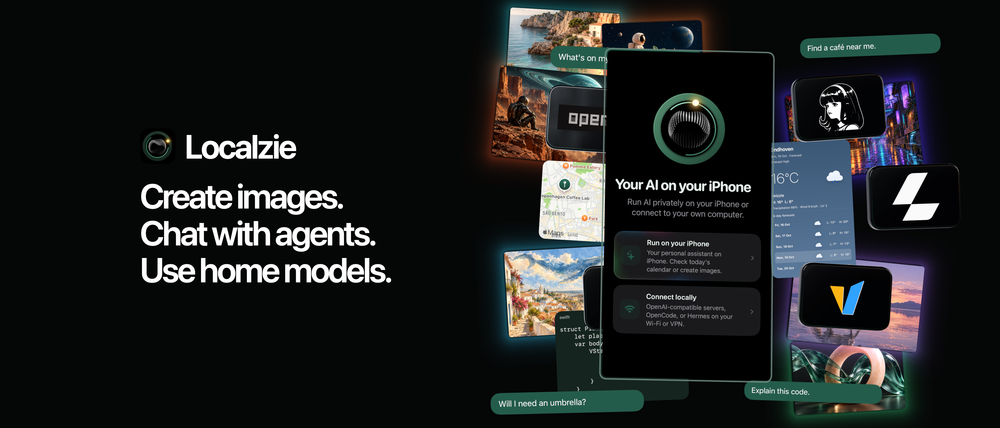
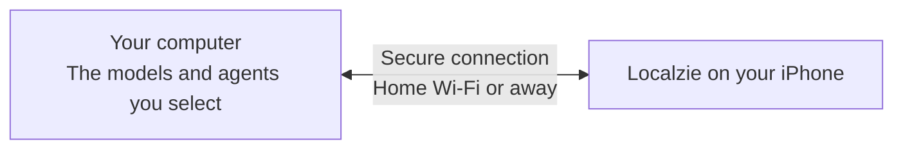

<div align="center">

# Localzie

[](https://github.com/manuelemosr/localzie-connector/actions/workflows/ci.yml)
[](LICENSE)

### Your computer's AI, on your iPhone.

Use your own models and coding agents from your phone. Keep working on an OpenCode, Hermes or Codex project, or chat with the models running on your computer.

**[Get Localzie on the App Store](https://apps.apple.com/app/id6813506926)** · **[Download the computer connector](https://github.com/manuelemosr/localzie-connector/releases)**

The open-source computer companion for Localzie.

[](https://apps.apple.com/app/id6813506926)

</div>

## How it works



## Connect your computer

Once the connector is installed, run:

```sh
localzie-connector setup
```

It finds your models and coding agents. Use the arrow keys to move, **Space** to check the ones you want, then **Enter** to connect.

```text
Localzie
Your computer's AI, on your iPhone.

What would you like to use in Localzie?

  [x] Ollama
  [x] OpenCode
  [ ] Codex

Space to select · Enter to connect
```

Setup saves your choices, starts the connector and gives you a private, one-use code. On your iPhone, open **Localzie → Connect to a server** and paste the code. Your selected services appear in the usual server list.

That's one command for setup and starting the connection. Keep the terminal open while you use Localzie; closing it stops the connector. Run `setup` again to change your choices. The CLI uses a copyable code; QR codes are for the UI version.

## At home and away

At home, Localzie prefers your home Wi-Fi. Remote access uses a secure connection managed by Localzie, with the same servers and chats in the app. You do not need a VPN app, public ports or a network to administer.

**Current preview:** fresh installs connect on your home network. The wizard preserves remote access on computers already set up by Localzie. Automatic remote activation for new computers is the next piece being connected to setup; there is nothing for you to provision.

## What can I connect?

- **Local models** through Ollama, LM Studio, llama.cpp, vLLM, Jan and other compatible model servers.
- **OpenCode** and **Hermes** for your existing coding-agent sessions.
- **Codex**, using the Codex installation already on your computer.

Start the service before running setup. OpenCode can be found through its existing local service information. Codex can be selected when installed. Services protected by a password or API key need their existing credentials to be available to the connector; see [help with discovery](docs/setup.md).

A computer without a display works too: run setup in its terminal. A text-only, screen-reader-friendly version is available with `localzie-connector setup --accessible`.

## Your computer stays yours

Only the services you check are shared with your paired phone. Your models and agents keep running on your computer. A setup code is private, expires after 10 minutes and works once.

Coding agents can work with files and run commands, so keep your pairing code safe, just as you would access to your computer. [Privacy and security details](docs/security.md).

## Download the connector

[GitHub Releases](https://github.com/manuelemosr/localzie-connector/releases) is where prebuilt downloads are published. Choose Mac for Apple silicon or Intel, or Linux x64/ARM64. Extract the archive and run `./localzie-connector setup`.

The first preview release is being prepared. Mac binaries are not Apple Developer ID signed or notarized yet.

## Install from source

The connector currently supports macOS and Linux. With Go 1.27 or newer installed:

```sh
go install github.com/manuelemosr/localzie-connector/cmd/localzie-connector@main
localzie-connector setup
```

Make sure your Go binary folder is on your terminal's PATH. Find it with `go env GOBIN`; if that is empty, it is `$(go env GOPATH)/bin`. If `localzie-connector` is not found, run it by that full path. The `@main` command above uses the current preview rather than an older cached release.

If you are already in this checkout, use `go install ./cmd/localzie-connector` to install exactly the code you have locally. If you built it with `make build`, run `./bin/localzie-connector setup`. The downloads are standalone binaries, rather than desktop installers.

## Help and development

[Setup help](docs/setup.md) · [Report a problem](https://github.com/manuelemosr/localzie-connector/issues/new/choose) · [Contribute](CONTRIBUTING.md)

The computer connector is open source under [Apache 2.0](LICENSE). Localzie for iPhone is available separately on the App Store. Developer references: [architecture](docs/architecture.md), [advanced configuration](docs/configuration.md), [integration pins](docs/integrations.md) and [dependency notices](THIRD_PARTY_NOTICES.md). Maintainers: [building and publishing releases](docs/releases.md).
