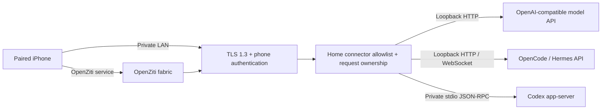

# Architecture

Developer reference. For the customer experience, start with the [README](../README.md) or [setup guide](setup.md). Customers use Localzie-managed remote access; these transport details are not customer setup requirements.

OpenZiti transports connections. The home TLS identity and phone credential are independent of the network enrollment. The configured endpoint allowlist, not the phone or OpenZiti controller, chooses upstream destinations.

| Package | Responsibility |
| --- | --- |
| `cmd/localzie-connector` | Primary foreground CLI: serve, enrollment, pairing, device revocation |
| `internal/ziticonn` | Unified LAN/OpenZiti listener, TLS rotation, API allowlist, explicit inference cancellation and request replay |
| `internal/agentbridge` | Native Codex app-server process, JSON-RPC, events and harness API bridge |
| `internal/discovery` | Local Bonjour advertisement |
| `internal/identity`, `internal/store` | Local identity, SQLite state, hashed phone credentials and one-use pairing |
| `cmd/localzie`, `internal/connector`, `internal/runtime`, `internal/harness`, `internal/protocol` | Older LAN protocol implementation and compatibility support |
| `internal/tunnel` | Shared framing used by the older connector's optional relay client; no relay server is included |

## Pairing and identity

A private terminal setup code contains home trust material, a one-time home pairing secret, the public endpoint catalogue and (for remote mode) one phone's OpenZiti enrollment. It contains no runtime API keys. Pairing stores only a hash of the phone bearer token on the home machine.

Each home has a persistent home ID and CA. Each configured endpoint has a persistent instance ID. Changing the configured runtime address, kind or project directory changes that endpoint's identity. Compatible clients keep histories scoped to the home and endpoint rather than to a display name.

A home CA signs renewable 90-day leaves, renewed within 30 days of expiry. Existing exact-leaf clients have a legacy certificate path. The home CA is scoped to the connection, never installed into the phone's global trust store. The CA itself expires after 10 years; automatic CA replacement is not implemented.

## Work ownership and reconnection

A phone disappearing detaches its subscriber. It must not cancel accepted inference. Explicit Stop has a separate cancellation route, and actual computation cancellation depends on the upstream honoring its canceled request.

V2 request UUIDs and timestamps establish durable acceptance before dispatch. Identical retries attach to the accepted operation and replay bounded output; conflicting bodies are rejected. Restarted unfinished work is marked uncertain and is never silently dispatched again. The request journal is local and bounded by time and size; it is not permanent encrypted transcript storage.

Harnesses remain authoritative for their own conversations. The connector uses APIs or native app-server stdio, never terminal scraping or edits to harness session files. Phone-owned model conversations remain a client concern.
